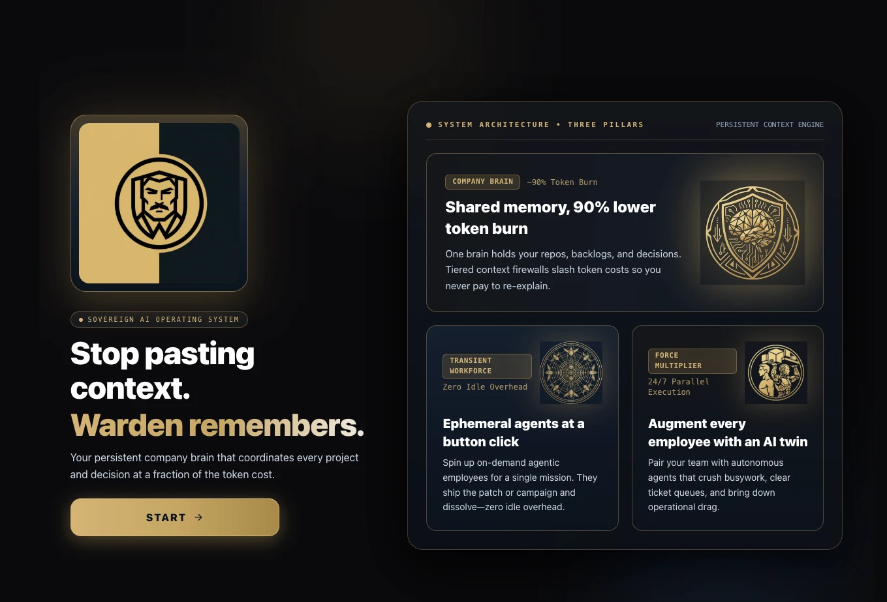
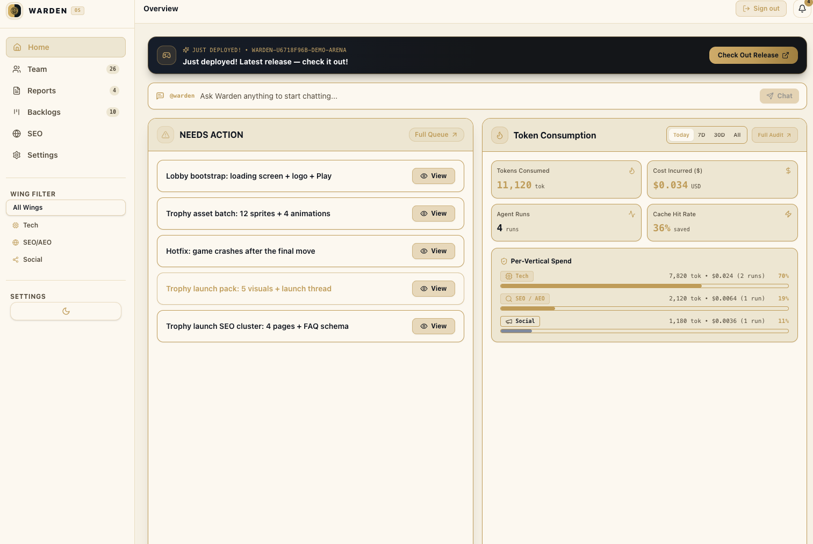

# Warden Automatons — Autonomous Multi-Agent Command Center & Chief of Staff Framework

**Live:** [warden.autos](https://warden.autos)

Warden Automatons (Warden for short) is an open-source (MIT) multi-agent orchestration framework and executive command center built for founders and engineering leaders. One human operator interacts with a single executive agent, `@warden`. Warden coordinates a corporate hierarchy of specialized agents across engineering, product, infrastructure, security, and growth, delivering compact, decision-ready briefs and verified code changes.

The platform ships a Node.js Control Plane API (`@warden/orchestrator`), a real-time React + Vite web dashboard (`@warden/web`), a PostgreSQL + `pgvector` hybrid memory engine (`@warden/db`), an ephemeral container/SSH sandbox manager with automated Playwright visual QA (`@warden/sandbox`), and a jailed local workspace execution daemon (`@warden/client` / `warden-link`).





The dashboard home shows what is waiting on you (**NEEDS ACTION**), a chat box to brief `@warden`, the latest demo release, and token spend per department. See [docs/PRODUCT_GUIDE.md](docs/PRODUCT_GUIDE.md) for every screen and flow.

---

## 1. The Bottom-Heavy Token Pyramid

Traditional multi-agent swarms suffer from catastrophic context bloat: root orchestrators ingest entire codebases, multi-megabyte conversation histories, and complete backlogs on every turn.

Warden inverts token flow into a **Bottom-Heavy Token Pyramid**:

- **Root Level (`@warden` — Chief of Staff)**:
  - Budget: Under 1,500 tokens per turn.
  - Strict Token Firewall: Never reads raw source files, repository trees, or raw task lists.
  - Responsibilities: Analyzes high-level operator intent, routes tasks across departments, and compresses upward telemetry into executive briefs.
- **Level 0 C-Suite (`@cto`, `@cmo`, `@cbo`)**:
  - Budget: Under 4,000 tokens per turn.
  - Strict Context Firewall: Consumes only scoped architecture docs, pinned preferences, and compact upward digests.
  - Responsibilities: `@cto` governs system architecture and chairs daily standups; `@cmo` and `@cbo` govern growth, SEO/AEO, and commercial priorities.
- **Level 1 Domain Leads (`@pm`, `@tech_lead`, `@infra_head`, `@sec_lead`, `@seo_aeo_head`, `@designer`)**:
  - Responsibilities: Own prioritized sprint backlogs, API contracts (`propose_contract`), infrastructure runbooks, and security gates.
  - Role in Pyramid: Consume symbol digests from Reader Scouts, deconstruct initiatives into minimal file-edit manifests (`FileEditDirective[]`), and fan out atomic tasks to Level 2 specialists.
- **Level 2 Sandboxed Developers & Scouts (`@reader_scout`, `@frontend_dev`, `@backend_dev`, `@infra_jr`, `@sec_auditor`)**:
  - **Fast Read Scout (`@reader_scout`)**: Scans source trees and emits $\le 150$-word symbol + line-range digests so Tier 1 planners never ingest raw files.
  - **Scoped File Appliers**: Execute inside isolated Docker sandboxes, cloud ephemeral VMs, or jailed local workspaces (`warden-link`), capped at $\le 8$ turns per shard (`MAX_L2_SHARD_TURNS = 8`) to prevent quadratic context snowballing.

---

## 2. Scout -> Plan -> Apply Execution Pipeline

Warden decouples code inspection, architectural reasoning, and mechanical file editing across three phases:

- **Phase 1 — Scout (`reader_scout`)**: Inspects repository files and returns compact symbol and line-range digests ($\le 150$ words).
- **Phase 2 — Architect (`planning` step)**: Level 0/1 agents reason over the digest using frontier models (`muse-wonder-1.0`, `muse-spark-1.3`) and emit structured `FileEditDirective[]` manifests.
- **Phase 3 — Applier (`tool_loop` step)**: Level 2 developers apply edits using high-speed models (`muse-light`, `muse-flash`) or local open-weights models via Ollama / vLLM (`llama-3.3-70b`, `muse-glimmer-30b`), followed by automated build and headless Playwright verification.

---

## 3. Meta-Native 3-Tier Model Router & Multi-Key Failover

`ModelRouter` (`packages/orchestrator/src/models/ModelRouter.ts`) routes every inference step across Meta cloud models and local Meta open-weights runtimes:

- **3-Tier Dynamic Resolution**:
  - **Tier A (Global Profile)**: `META_MUSE_HACKATHON`, `LOCAL_ZERO_COST`, or `CUSTOM_HYBRID`.
  - **Tier B (Per-Agent Primary + Fallback)**: Automatic cross-provider failover if a primary endpoint is unreachable.
  - **Tier C (Per-Step Intra-Run Routing)**: Dynamically switches models within a single run (`planning` -> `muse-spark-1.3` / `muse-wonder-1.0`, `tool_loop` -> `muse-light`, `compaction` -> `muse-glimmer-30b`, `creative_image` -> `muse-image`, `voice_note` -> `muse-voice`).
- **Multi-Key Credential Pool & BYOK**:
  - `CredentialPoolManager` rotates API keys on HTTP `429`, `402`/`403`, or `5xx` with automatic cooldown timers and failover telemetry.
  - **Bring Your Own Key (BYOK)**: Operators can store AES-256-GCM encrypted Meta Muse keys in the dashboard (`UserLlmKeys`), bypassing shared platform token caps.

---

## 4. Hybrid Memory Engine (`PostgreSQL + pgvector`)

`HybridMemoryEngine` (`packages/orchestrator/src/memory/HybridMemoryEngine.ts`) combines deterministic SQL context with vector recall:

- **Deterministic SQL Injection**: Always injects the agent's role prompt, allowed repositories, matching `project_contexts` (`architecture_doc_md`, build/test commands), active sprint plan, and pinned memories (`PINNED_PREFERENCE`, `CEO_DECISION`).
- **768-Dim Pinned Semantic + Keyword Recall**: Queries `agent_memories` (`EPISODIC_LESSON`, `REPO_GOTCHA`), past `chat_messages`, and indexed `code_chunks` using `pgvector` cosine similarity (`vector(768)`) blended with normalized keyword overlap.
- **Zero-Drift Offline Embedding Fallback**: Pinned to `muse-embed-1.0` (768 dimensions) with a deterministic MD5 word/bigram + FNV-1a character trigram feature-hashing fallback so vector search operates reliably even in offline/local environments.

---

## 5. Runaway Watchdogs, Sandboxed QA & Local Workspace Link

- **`HealthAndQuotaGuard` (15s Watchdog Sweep)**:
  - **Anti-Fork-Bomb Caps**: Enforces `MAX_DEPTH = 4`, per-agent concurrency limits (`max_subagents = 4`), and per-run spawn limits (`MAX_SPAWNS_PER_RUN = 12`).
  - **Stuck-Loop Circuit Breaker**: Trips `STUCK_LOOP` if an agent invokes the same tool with identical arguments and fails 3 times consecutively.
  - **30-Minute Hard Timeout**: Automatically snapshots uncommitted work to a `wip/timeout-<runId>` branch before terminating the container.
  - **Per-Run & Per-Operator Token Caps**: Pauses runs (`PAUSED_TOKEN_CAP`) and raises an interactive `ApprovalGate` when budgets are reached.
- **`PlaywrightQAGate` (`packages/sandbox/src/PlaywrightQAGate.ts`)**:
  - Runs `npm run typecheck`, `npm run build`, boots the preview server, and launches headless Chromium with WebGL flags (`--use-gl=angle`, `--use-angle=swiftshader`) to assert HTTP 200 and zero console/page errors before completion.
- **`warden-link` Local Client (`packages/client`)**:
  - Lightweight CLI daemon (`warden-link start --url <api> --key <jwt> --workspace <dir>`) that polls the control plane and executes `read_file`, `write_file`, and `pushit` commands inside a path-jailed local repository while blocking access to `.env` and private keys.

---

## 6. Live Web Dashboard & Omnichannel Command Surface

- **Real-Time Web Dashboard (`packages/web`)**:
  - Built with React 19, Vite, and Tailwind CSS, synchronized over authenticated WebSockets (`/ws`).
  - Includes the **Priority Window & Approval Gates**, **Workforce Floor & Agent Studio**, **Chat Center** (with live thinking/tool trace inspector), **Sprint & Kanban Backlog Board**, **Automated SEO & AEO Auditor** (`/llms.txt` + JSON-LD generator), and **Consultation Knob** (autonomy level tuner).
- **Messaging & Reminder Bridges**:
  - Includes a pluggable messaging command center (`packages/orchestrator/src/bridge/whatsapp/`) supporting voice note transcription, interactive standup approval buttons, and multi-channel cron reminders (`packages/orchestrator/src/reminders/`).

---

## 6.5 What the Runtime Enforces (and What It Does Not)

The pyramid is enforced in code, not only in prompts. See `packages/orchestrator/src/engine/tierPolicy.ts` and its tests.

- **Upward word caps**: Every subagent reply is trimmed to its tier cap before it enters the parent context (Level 0: 120, Level 1: 150, `reader_scout`: 150, Level 2 appliers: 200). The full output stays on the child run.
- **Raw-source firewall**: `read_file` refuses source files for `@warden`, Level 0, and Level 1 agents. They read docs only and must delegate code reads to `@reader_scout`.
- **Path containment**: File tools use `path.relative` containment, so `../` and sibling-prefix paths are rejected.
- **Honest tool results**: Missing files, refused writes, unapplied edits, and commands with no sandbox session return `ok: false`. The QA gate reports "not run" when Playwright is unavailable.
- **Telemetry provenance**: Token and cost numbers come only from the provider `usage` block. Tool steps and simulated (offline, no API key) turns record zero, and simulated steps are labelled `[simulated]`. Demo workspaces ship with labelled seed history.
- **Sandbox modes**: Runs use a Docker container when the `warden-workspace` image is available. Otherwise they fall back to LOCAL mode (host process behind `PermissionGuard`) and log a warning. `PermissionGuard` is a command denylist, not a security boundary, so treat LOCAL mode as dev-only and set `WARDEN_REQUIRE_DOCKER=1` to forbid the fallback.
- **Outbound fetches**: The SEO audit fetches only public `http`/`https` URLs. Private, loopback, link-local, and cloud-metadata addresses are rejected, and every redirect hop is re-checked (`packages/orchestrator/src/seo/urlGuard.ts`).
- **Local workspace jail**: `warden-link` resolves symlinks before reading or writing, so a link inside the workspace cannot reach files outside it, and secret files (`.env`, keys) are refused even behind an innocently named link.
- **CORS**: Set `WARDEN_CORS_ORIGIN` to your dashboard origin in production (defaults to `*` for local dev).

Run the checks:

```bash
npm run typecheck
npm test
```

Tests cover the tier policy, URL guard, JWT verification, `PermissionGuard`, the `warden-link` path jail, the watchdog, routing, the store, and token accounting.

---

## 7. Monorepo Layout

```text
warden/
├── .env.example                      # Environment template (Meta Muse API, Postgres, Auth, Sandbox)
├── AGENTS.md                         # Coding agent instructions and architectural conventions
├── README.md                         # Architecture and quickstart documentation
├── docker-compose.yml                # PostgreSQL 16 + pgvector container definition
├── packages/
│   ├── db/                           # PostgreSQL + pgvector schema, store, and JSON snapshot fallback
│   ├── sandbox/                      # Docker/SSH sandbox manager, PermissionGuard, PlaywrightQAGate
│   ├── orchestrator/                 # HTTP/WS control plane, AgentRunner, ModelRouter, watchdogs, auth
│   ├── web/                          # React + Vite command center dashboard
│   └── client/                       # warden-link local workspace execution daemon
└── scripts/
    ├── build.mjs                     # Workspace build orchestrator
    ├── remind.mjs                    # Reminders API CLI
    └── token-report.mjs              # Session token and cost telemetry analyzer
```

---

## 8. Quickstart

**Prerequisites**: Node.js 20+ and Docker (for PostgreSQL + `pgvector`).

```bash
# 1. Install workspace dependencies
npm install

# 2. Configure environment
cp .env.example .env
# Edit .env and set META_MUSE_API_KEY (or configure your key later in the Dashboard Settings UI)

# 3. Start PostgreSQL + pgvector and launch the stack
npm run db:up
npm run dev:db

# 4. Verify build & type safety across all workspaces
npm run typecheck
npm run build
```

- **Web Dashboard**: `http://localhost:5173` (or `https://localhost:5173` when `WARDEN_HTTPS=true`)
- **Control Plane API & WebSocket**: `http://localhost:4000` (`/api/*` and `/ws`)

---

## 9. Running Without an API Key

- With no `META_MUSE_API_KEY` (and no key saved in **Settings**), the model router answers with a deterministic, role-aware **simulation** so the dashboard and flows can be explored offline. Simulated steps are labelled `[simulated]` and record zero tokens and cost.
- Memory recall falls back to deterministic feature-hashing embeddings when the embeddings endpoint is unavailable.
- For real agent replies, set `META_MUSE_API_KEY` in `.env` or paste your key in **Settings → Your Meta Muse API key**. Model ids and the endpoint (`META_MUSE_BASE_URL`) are configurable per agent and per routing profile.

---

## 10. Project History

Warden started as the founder's private, multi-project command center. The reusable framework was extracted, sanitized, and published to this repository on 2026-10-27 (the first commit here is that import), and development has continued in this repository since. Later commits remove features that depended on the private setup (multi-repo mirrors, GitHub and Telegram integrations, non-Meta model providers).

